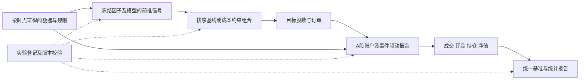

# A 股多因子、多模型回测框架：文献判断与项目基准规范

检索与项目核验日期：**2026-10-25**。适用范围：当前项目的沪深 A 股、日频 Alpha158、六个收益预测模型及滚动预测。本文是框架选择与实施规范，文中的示例参数不是经过验证的最优策略参数。

## 1. 推荐结论

**建议采用“Qlib 研究基准 + A 股事件驱动账户与撮合适配层 + 成本感知组合构建 + 冻结方案后的前推评价”架构。**

如果只选一个研究平台，优先选择 **Qlib**：它与现有 Alpha158 和模型输出最贴近。如果选择交易账本的实现，优先评估 **RQAlpha 开源版及其自有数据适配**；如果数据接口或版本无法满足本项目，则保留同一个交易接口，实施一个范围明确、可以逐笔核对的日频引擎。不要同时维护两套互不一致的净值主账本。

这是针对本项目的工程判断，并非文献证明某一软件在所有 A 股策略上最优。依据是 Qlib 的研究组件、RQAlpha 的中国市场扩展能力以及组合优化文献；正式接入仍需版本锁定、数据适配和验收。[^qlib] [^qlib_strategy] [^rqalpha] [^boyd]

**在本次检索中，最贴近 A 股的近期前沿评测范式是 Quant-Arena（2026-10-21），但它是研究基准，不是本项目可直接替换上的完整交易引擎。** 它强调研究预算、策略冻结和封闭测试，并在现金账户中评价交易成本。其数据包含 Level-2，而本项目目前是日线，因此适合借鉴协议，不能声称已经复现其执行精度。[^arena]

首版先用等权 Top-K/Topk-Dropout 建立可核对基线，再增加风险与成本约束优化。强化学习、LLM 自动研究和多周期执行作为后续研究分支，使用同一交易引擎和评价协议比较。

## 2. “前沿”应体现在哪些地方

本项目的判断标准是：

| 标准 | 需要回答的问题 |
| --- | --- |
| 时点一致 | 下单时是否真的知道所用因子、股票状态和模型参数？ |
| 可执行 | 目标持仓是否符合资金、可卖数量、板块申报和价格限制？ |
| 成本与容量 | 换手、最小佣金、参与率和冲击是否会改变模型排名？ |
| 公平比较 | 六模型是否面对同一股票池、订单规则、资金和测试日期？ |
| 研究过程可审计 | 是否记录所有候选，而不是只保留最好的一条曲线？ |
| 可复现 | 能否由固定的信号、行情、规则和版本重新生成相同账本？ |

模型预测、组合优化、交易模拟和统计检验是四个不同层次。较低 RMSE 或较高 RankIC，只能证明相应口径的预测表现；交易表现还取决于信号头部质量、换手、约束与成交。这个分层判断也与 Qlib 的预测—策略接口、组合优化框架相符。[^qlib_strategy] [^boyd]

## 3. 文献证据与适用边界

以下覆盖基础方法和 2025—2026 年的相关研究，是针对当前问题的定向检索，不是穷尽性系统综述。

| 文献 | 与本项目相关的贡献 | 本项目采用的部分 | 不能直接推出的结论 |
| --- | --- | --- | --- |
| Yang 等，Qlib，2020 | 面向 AI 量化研究的基础设施 | 因子、模型、策略与实验的接口和基准 | 默认配置已完整覆盖全部 A 股历史规则 |
| Boyd 等，Multi-Period Trading，2017 | 在组合决策中协调收益预测、风险、成本和约束 | 先单周期成本约束优化，再按需扩展多周期 | 未经收益校准的排名分数可直接作为预期收益 |
| Bailey、López de Prado，DSR，2014 | 考虑多重尝试和非正态收益导致的表现膨胀 | 记录研究尝试，增加选择偏差诊断 | 一个统计量可以保证未来盈利 |
| Bailey 等，PBO，2016 在线／2017 卷期 | 提出回测过拟合概率和 CSCV 实现 | 在具备完整候选收益矩阵时作补充诊断 | CSCV 等于可真实交易的时间前推流程 |
| Liu 等，FinRL-Meta，2022 | 金融 RL 环境与基准组织方式 | 后续 RL 分支接入统一环境接口 | 默认环境已满足本项目的全部交易约束 |
| Li 等，R&D-Agent-Quant，2025 | 自动化因子—模型联合研发循环 | 候选登记、实验预算和研发记录 | 自动研究循环能替代真实撮合与最终留出验证 |
| Abbade、Costa，真实冲击成本环境，2026 | 展示成本模型会影响策略行为及算法比较 | 插件化成本、容量压力和逐笔记录 | NASDAQ-100 的冲击系数可直接用于 A 股 |
| Santoni 等，MinervaScore，2026 | 将多类统计稳健性证据组织成报告 | 借鉴多维证据呈现，保留各项原始诊断 | 综合分数代表未来盈利概率 |
| Qian 等，Quant-Arena，2026 | A 股研究过程、策略冻结与交易评价相连 | 限制研究反馈、冻结后评价、统一执行条件 | 新基准排名代表已验证的生产收益优势 |

来源分别见文末论文记录。[^qlib] [^boyd] [^dsr] [^pbo] [^finrl] [^rdagent] [^impact] [^minerva] [^arena]

### 对近期论文的具体判断

Quant-Arena 使用固定研究期与封闭评价期，并给出现金账户的组合结果；论文报告被评价的九个模型都未战胜其 2024 年等权市场参考。它支持我们重视“信号如何转化为组合”，不能作为更换模型后必然获利的证据。该论文刚发表，本文将它视为近期研究范式之一。其固定股票集合也不自动证明完成了动态历史股票池建设。[^arena]

2026 年冲击成本论文在 NASDAQ-100 上实验；其限制部分同时说明使用固定成分，并将 HPO 目标设为 OOS Sharpe。本项目借鉴成本建模思想，但不会把那个 OOS 调优口径照搬成“未参与选参的最终测试”。[^impact]

MinervaScore 的公开稿也报告：其未见真实市场验证没有发现显著的前向预测关系。因此本项目优先展示成本、回撤、稳定性和统计量，不以新颖综合分数替代这些证据。[^minerva]

## 4. 软件选择：各自承担什么工作

| 组件 | 建议用途 | 适配成本与限制 | 本项目判断 |
| --- | --- | --- | --- |
| Qlib | 模型研究基准、信号—策略接口、Topk-Dropout 对照 | 需要行情字段与复权适配；默认费用、单一涨跌幅阈值和交易单位不能直接当作全板块历史规则 | 研究层首选 |
| RQAlpha | 事件驱动交易账户、订单、成交及自有数据对接 | 开源版、Plus 和数据服务要分别核验；不能把 Plus 文档里的所有功能视为开源版承诺 | 交易层优先候选 |
| pandas / NumPy / VectorBT | 快速信号分析、参数敏感性、简化组合试算 | 需明确实现资金共享、申报和成交约束；速度不能替代规则验收 | 探索与交叉核对 |
| Cvxportfolio / CVXPY 思路 | 风险与成本约束组合决策 | 需要校准收益和风险；连续权重解仍需转成合法股数 | 第二阶段组合模块 |
| FinRL-Meta 等 RL 环境 | 后续策略学习、执行研究 | 需要相同数据与 A 股规则适配，增加研究预算 | 主账本稳定后接入 |

这些用途依据官方文档，不是本次对各软件进行的同场速度或收益测试。VectorBT 也支持订单和账户模拟，表中的限制针对“未经适配就直接套用”的用法。[^qlib_strategy] [^qlib_exchange] [^rqalpha] [^rqalpha_plus] [^vectorbt] [^cvxportfolio] [^finrl]

Qlib 支持买卖方向分别限制和自定义交易组件，应该使用这些扩展点。尤其不能对本项目所有主板、创业板和科创板股票统一使用一个 9.5% 阈值或同一个买入数量规则。[^qlib_exchange]

## 5. 当前项目核验结果

核验对象为 `E:\document-prefer\python for finanace\multi-model-bactest`。这里只核对结构、版本及运行状态，不使用测试期收益数值挑选策略。

| 项目 | 核验结果 |
| --- | --- |
| 原始数据 | 已有日线、复权因子、daily_basic、股票基础信息、交易日历和沪深 300 指数日线 |
| Alpha158 | 运行 `run_20261024T123322Z_3e71525d`，158 个原始因子 |
| 标签与预处理 | 运行 `run_20261024T125348Z_2adc3b07`，当前目标为 LABEL0 |
| 因子筛选 | 运行 `run_20261025T025453Z_89427e7a`，40 个因子；筛选区间为 train |
| 正式训练 | `run_20261025T114810Z_ce49dd93` 状态 complete，包含六模型；训练样本上限 100000、三个时间验证窗口 |
| 静态测试 | 上述运行内已有 `test_evaluation` 及其元数据 |
| 滚动预测 | `run_20261025T122254Z_28994c61` 状态 complete，覆盖 2025 年四个窗口、六模型 |
| 信号与组合 | 已有 `signal&conbination.ipynb` 文件，但核验时为 0 字节 |
| 正式交易回测 | 尚未看到独立的订单—成交—账户主账本产物 |

现有模型产物已经足以进入信号与组合模块。滚动预测报告仍是预测评价，不能直接当作含交易约束的策略净值。

还需注意：训练运行的顶层 `test_evaluated` 标记没有随着可选测试输出同步更新；本次以实际存在的 `test_evaluation` 元数据和滚动产物交叉核对。后续实验登记应汇总子运行，避免只读顶层布尔值。

### 已经评价过的 2025 年如何使用

首次冻结后生成的 2025 年结果，可以保留为那个版本的历史留出评价。**如果此后依据这些结果改变因子、模型、持仓规则或费用假设，2025 年就不能再次充当新版本从未使用过的最终测试。**

下一轮应把新方案及其研究预算先登记，使用新的未见数据或冻结之后的前向模拟验证。2022—2025 年仍可用于标记清楚的开发诊断、执行测试和历史稳健性研究。

## 6. 推荐架构与数据接口



各模型通过同一信号接口接入，不把模型种类写进交易引擎。建议将研究接口约定为：

```text
PredictionSource -> signals
PortfolioPolicy(signals, known_market_state, holdings) -> target_weights
OrderPlanner(target_weights, cash, holdings, rules) -> orders
ExecutionModel(orders, realized_market_events, rules) -> fills / rejections
AccountLedger(fills, corporate_actions, valuation_prices) -> daily_nav
Evaluator(daily_nav, benchmarks, execution_logs) -> reports
```

其中 `PortfolioPolicy` 只能读取决策时已经公开的信息；`ExecutionModel` 可以读取之后真实发生的市场事件来模拟订单成交，但不能把这些事件倒传给之前的选股与下单决策。

### 信号字段

| 字段 | 含义 |
| --- | --- |
| `signal_date`、`instrument`、`model`、`score` | 现有滚动预测可以提供的主键和分数 |
| `signal_available_at` | 因子与模型输出真正可供下单的时点 |
| `earliest_execution_at` | 该信号允许开始成交的最早时点 |
| `model_available_after`、`max_train_label_end` | 模型及训练标签可用性校验 |
| `model_run`、`fold`、`source_hash` | 固定模型、窗口与上游版本 |
| `label`、`label_end_date` | 仅供事后评价，不能进入交易决策输入 |

现有 `(datetime, instrument)` 索引应保留，同时明确 datetime 表示信号日。`label_usable`、`supervised_eligible` 等依赖未来标签的标记，不得用于决定当日哪些股票可以买。交易股票池只能使用当时可知的数据与特征资格。

## 7. 成交时点：先与现有 LABEL0 对齐

本项目当前标签定义为：

```text
LABEL0(t) = adjusted_close(t+2) / adjusted_close(t+1) - 1
```

这里的 `t+1`、`t+2` 指市场交易日。首版建议选择下列明确口径：

| 时间 | 操作 |
| --- | --- |
| t 日收盘数据可用后 | 生成信号；只使用此时可用的模型与历史数据 |
| t+1 日成交前 | 根据已知信号、现金、现有持仓和已知状态提交订单 |
| t+1 日收盘 | 对预先存在的订单，使用收盘价作为日频模拟成交参考并扣费 |
| t+2 日及之后 | 按持仓规则卖出或继续持有；每个交易日根据真实账户盯市 |

这是“次日收盘参考成交”的日频研究模型，不代表订单必然能在收盘集合竞价全部成交。严格模拟还需要对应成交窗口的流动性数据。

不能用 t+1 日最终收盘价预先精确计算下单股数，再声称订单在收盘前已经提交。股数和预算应基于当时已知价格或明确的委托规则生成；成交后检查真实现金是否足够，不足时缩量或拒单并留日志。

如果以后采用次日开盘或盘中 VWAP 成交，应重新定义执行收益、持有区间和评价标签，或者明确报告模型标签与实际交易收益的差异。现有 close-to-close 标签不自动等于 open-to-close 策略收益。

账户净值由持仓和行情生成，不能直接把选中股票的 LABEL0 平均值连乘当作正式策略净值。停牌、没有预测的新持仓、未成交订单和现金都必须继续留在账户里。

## 8. A 股交易规则与数据缺口

### 8.1 按日期和板块管理规则

规则建议保存为带 `effective_from`、`effective_to`、板块和来源版本的表，不写成一个永久常数。

| 项目 | 引擎必须执行的约束 |
| --- | --- |
| T+1 | 分开记录总持仓与可卖数量；当日新买股份不能当日卖出；解锁使用交易日历 |
| 板块数量规则 | 区分主板/创业板与科创板；实现各自最低申报、递增单位及零股卖出规则 |
| 涨跌停 | 优先使用历史涨跌停价；按买卖方向判断；处理 ST、IPO、退市整理与规则变更 |
| 停牌与数据缺失 | 无可成交行情时不成交；数据缺失与真实停牌分别记录 |
| 资金约束 | 扣除费用、预留资金和已冻结委托后再检查买单；明确卖出所得可买入与可取资金的区别 |
| 部分成交 | 未成交的卖单不能释放虚构资金；未成交买单不能产生持仓 |
| 公司行动 | 股份变化、现金分红、税费、除权和到账时点分开处理 |
| 退市与终值 | 不删除持仓，不默认以最后收盘价全部变现；使用实际处置数据或披露不可变现与压力估值 |

两个容易写错的历史例子：深市主板的整手规则与科创板不同；科创板竞价买入最低 200 股，超过部分可以按 1 股递增。创业板风险警示股票也不能统一套用主板 ST 的 5% 限制。[^szse_main] [^star_rules] [^gem_st]

主板注册制 IPO、科创板和创业板的无涨跌幅限制期间应按当时适用规则处理。现在查到的上交所 2026 年修订规则，不能直接反向套用到 2022—2025 年。[^szse_main] [^star_rules] [^sse2026]

### 8.2 当前还需补齐的数据

| 数据 | 当前情况与建议 |
| --- | --- |
| 未复权 OHLCV、成交额、交易日历 | 已有，作为交易价格和市场时间基础 |
| 历史上市、退市区间 | 已有部分基础资料；仍需核验历史覆盖和代码变更，不能把当前股票集合当作完整 PIT 证明 |
| 每日涨跌停价、历史 ST/风险警示、真实停复牌事件 | 未在当前原始目录中看到独立专用数据；正式规则层应补齐或提供可核验的历史来源 |
| 分红、送转、配股及到账事件 | 未看到专用公司行动目录；严格原始股数账本需要补齐 |
| 历史行业、指数成分与权重 | 当前基础表的行业不能自动视作历史行业；行业约束或指数增强前补齐 |
| 收盘竞价/分钟成交量、价差、盘口 | 未看到；日成交量不能等同于收盘竞价可成交量 |
| 全收益基准 | 已有沪深 300 行情；全收益序列尚需单独核验 |

“目录中未看到”不等于用户一定没有这些数据；这是本次可核验范围。股票池保留退市历史有助于降低幸存者偏差，但仍需验证是否遗漏退市、换码或历史不可交易状态。

### 8.3 两个结果等级

- **研究级基线**：使用现有日线和复权序列、保守可交易性假设，明确标注数据缺口，适合信号及策略比较。
- **执行约束验证版**：使用完整历史状态、公司行动和原始股数账户，通过规则测试后才使用这个标记。

缺少关键字段时，应降级标记或停止严格模式，不能把缺失状态默认为“全部可交易”。

研究用复权收益账本与原始股数现金账本必须区分：前者若已通过复权计入分红送转，不再重复增加现金分红；后者需要实际公司行动。价格和成交量的单位也要明确：本项目 Tushare 原始 `vol` 为手、`amount` 为千元，进入账本分别转换为股和元。复权后的研究成交量不能直接充当实际股数容量。

## 9. 交易成本与容量模型

### 9.1 显性费用

```text
成交费用 = 券商佣金 + 印花税 + 过户费 + 未包含在佣金中的其他实际费用
执行损耗 = 价差 / 滑点 + 市场冲击
```

佣金及最低收费采用明确的账户合同或实验假设，不把示例中的“最低 5 元”当作所有账户的统一事实。经手费、监管费是否已包含在佣金中也要登记，避免重复扣费。

本项目历史窗口跨越了费用调整：2023-08-28 起证券交易印花税减半；中国结算记录了 2022 年股票交易过户费下调。必须按成交日期查费率表，不能把 2025 年费用固定用于整段 2022—2025 年。中国结算 2025 年官方收费表的检索记录列示 A 股过户费为成交金额 0.01‰、买卖双方收取；历史生效表仍需在实施时归档核验。[^stamp] [^transfer_history] [^transfer_table]

### 9.2 容量与冲击

建议的可解释起点为：

```text
ADV20 = 决策时已知的过去20个交易日平均成交额
sigma20 = 同一已知窗口的日收益波动
participation = 本笔成交金额 / ADV20
impact_fraction = eta * sigma20 * sqrt(participation)
impact_cost = 本笔成交金额 * impact_fraction
```

这是参考冲击成本研究设计的**待校准近似**，不是已经在本项目 A 股样本上估计好的模型。`eta` 应使用独立的历史执行资料校准，或作为明确的压力情景。平方根模型及成本敏感性有文献依据，具体系数与适用区间需要本地检验。[^impact]

规划订单时只使用已知 ADV，不用当日尚未发生的成交量。模拟实际成交时可以应用该成交窗口的事后容量约束，但不能据此回头重排当时的候选股票。只有日线时，以日成交量截断订单最多是一个粗糙代理，不能声称它刻画了集合竞价排队。

建议预登记基础、两倍、三倍执行损耗，以及不同资金规模、参与率上限的压力测试。展示完整情景矩阵，不从压力测试里挑出净值最好的一组作为默认结果。

## 10. 组合构建：先有基线，再增加优化

### 10.1 第一版：等权 Top-K 与换手缓冲

可采用一个事前登记的起始方案：Top-50、目标股票仓位 95%、其余保留现金、每日检查并最多替换 5 个候选。这里的 50、95% 和 5 是工程基线示例，不是本文发现的最优参数。

换手缓冲借鉴 Qlib 的 Topk-Dropout：保留仍在合理排名区间的旧持仓，减少相近分数之间反复买卖。实际替换数仍受可卖数量、涨跌停、资金和成交约束限制，不保证每次都持满 K 只。[^qlib_strategy]

必须预先规定：边界并列按股票代码等稳定规则排序；信号缺失时如何处理已有持仓；卖单失败后如何处理买单。不能使用未来标签决定候选是否可用。

### 10.2 第二版：成本与风险约束优化

参考组合优化文献，可以在每个决策时点求解：[^boyd]

```text
最大化：mu' * w - lambda_risk * w' * Sigma * w - lambda_cost * C(w - w_pre)

约束示例：
    w >= 0
    sum(w) <= 1 - cash_buffer
    w_i <= single_name_cap
    turnover <= turnover_budget
    卖出数量 <= 当时可卖数量
    买卖金额符合容量约束
    有可靠历史行业数据时，再增加行业暴露约束
```

`w_pre` 是经过价格漂移后的真实持仓权重，不是上次下单的目标权重。风险矩阵使用当时可得收益估计并做收缩，必要时采用因子风险模型。

不能直接把百分位排名填入 `mu` 后宣称得到经济意义上的均值—方差最优解。可选择在训练/开发期校准分数到预期收益，或者把优化明确称作风险约束的排名配置。两种做法都要在最终评价前固定。

连续权重求解后还要转换为合法股数，再检查费用、现金、行业与集中度。整手、最低申报和最小佣金会引入非凸因素，不能宣称一次连续凸优化已精确解决全部交易限制。

多周期优化和 RL 可在后续加入；其增益必须在相同信号、数据、费用和撮合条件下与上述两种策略比较。

## 11. 公平比较的 benchmark 设计

### 11.1 必须保留的对照

| 对照 | 用途与口径 |
| --- | --- |
| 现金 | 区分选股增益与仅降低市场暴露的效果；现金利息假设统一 |
| 沪深 300 参考 | 使用现有指数数据作市场参考；注明价格指数还是全收益指数 |
| 同股票池的等权组合 | 控制全市场/小盘暴露；按相同调仓、费用和成交规则模拟 |
| 简单历史动量等透明信号 | 检查复杂模型是否优于简单规则，所有输入同样满足时点要求 |
| 事前固定种子的随机排名组合 | 给出完整分布，不能挑最好的随机种子 |
| 六模型各自的同规则策略 | 检验预测方法差异如何转化为净交易结果 |

基准要区分“无交易成本的指数参考”与“经过同引擎模拟的可交易对照”。策略含分红而基准只用价格指数时，应披露差异，并补充匹配的全收益比较；暂缺历史指数成分时，不称为完成了严格指数增强归因。

### 11.2 推荐比较矩阵

第一阶段为 **6 个模型 × 1 套等权/换手缓冲规则**，先固定执行口径。第二阶段再增加同一个成本约束优化器，形成 **6 × 2** 的组合比较。

模型融合如等权排名平均，可作为预登记的额外候选，不在测试期搜索融合权重。所有版本固定相同的初始资金、日期、历史股票池逻辑、调仓时点、费用和规则。

先将评价单位定义为“冻结的完整策略版本”，包括模型、因子、组合参数和执行假设；不要只记录模型名称。模型超参数搜索次数之外，改 K、调仓频率、股票池和费用假设也构成研究尝试。[^dsr] [^pbo]

## 12. 验证与统计报告

### 12.1 时间协议

1. 当前 40 因子在 2022—2023 年筛选，2024 年可作其后的模型验证；不能再把 2023 年称作这组因子的独立未见验证期。
2. 后续若做嵌套时间验证，各折的因子筛选、填补、缩放、收益校准和模型选择都限制在该折允许的历史中。
3. 用实际 `label_end_date` 清除跨边界标签；多日标签按完整事件区间判断重叠，不用一个随意的固定天数替代。
4. 扩展/移动窗口、重训频率及超参数在前推评价前固定。新窗口只能用届时已实现的标签更新拟合参数。
5. 最终冻结后才评价新的未见区间。已经用于调整策略的结果归入开发记录。

主评价采用时间前推。CSCV/PBO 或组合式交叉验证可作开发区间内的补充稳健性诊断，但不能把允许未来区块参与拟合的统计重采样结果当作可执行的历史净值。[^pbo]

### 12.2 报告指标

| 层次 | 指标 |
| --- | --- |
| 预测 | RMSE、相对零收益 RMSE、每日 IC/RankIC、覆盖率及头部组合收益 |
| 账户收益 | 总收益、年化收益、每日净收益、相对基准收益及超额净值 |
| 风险 | 年化波动、最大回撤、回撤持续时间、Sharpe、信息比率 |
| 交易 | 目标/实际换手、委托/成交金额、成交率、拒单原因、平均持有期 |
| 成本与容量 | 佣金、税费、滑点和冲击分别列示；参与率与资金规模压力结果 |
| 稳定性 | 年/月/滚动窗口结果、模型种子、执行情景和风格暴露 |
| 选择偏差 | 完整尝试次数；条件满足时报告 DSR、PBO 等，并披露假设与估计不确定性 |

日频年化常数统一登记，例如 252；无风险利率及现金收益假设保持一致。当前 `model.ipynb` 的日度 ICIR 是未年化口径，不能与乘了 `sqrt(252)` 的指标混用。

换手同时报告两种定义：`gross_traded_notional / NAV_pretrade` 和其一半的单边口径；不要将替换股票数量比例与金额换手混写。几何超额净值与每日主动收益差也分别命名。

置信区间按交易日期做适当区块重采样，保持同日股票和策略之间的关联；不把几百万个股票—日期样本当作几百万个独立的策略收益观测。DSR 的尝试数量及候选相关性需要记录；PBO 需要候选收益矩阵，不能只凭一条最好曲线输出可信数值。[^dsr] [^pbo]

## 13. 建议输出与验收

每次运行生成独立 `run_...`，配置和来源固定后再开始评价：

```text
data/processed/backtest/run_<time>_<id>/
    config.json                  # 策略、初始资金、费用和评价约定
    source.json                  # 信号、行情、模型和规则版本及哈希
    rules_snapshot.json          # 生效区间、板块规则和来源
    signals.parquet              # 含信号可用时点
    target_positions.parquet     # 目标权重及合法化后的目标股数
    orders.parquet               # 含提交时间、方向、数量、状态和原因
    fills.parquet                # 成交时间、价格、数量、各项费用
    rejections.parquet           # 资金/T+1/涨跌停/停牌/流动性等原因
    positions.parquet            # 总持仓、可卖与冻结数量
    account.parquet              # 现金、预留资金、资产与净值
    daily_returns.parquet
    benchmark_returns.parquet
    execution_summary.csv
    performance_summary.csv
    robustness_report.md
    metadata.json                # 引擎/依赖版本、完成状态、结果等级
```

正式验收至少覆盖以下场景：

1. 当日买入股份不能同日卖出；下一交易日才能按规则解锁。
2. 主板与科创板的最低申报、递增及零股处理分别正确。
3. 涨停买入、跌停卖出及真实停牌按方向与执行假设处理。
4. 卖单未成交时不释放资金，资金不足时不出现未授权负现金。
5. 部分成交、撤单和未完成委托均能追溯，不能直接把目标持仓写成实际持仓。
6. 分红送转不会因复权与公司行动重复计入，股数及净值可以人工核对。
7. 退市、信号缺失和样本缺标签不会使已有持仓从账本消失。
8. 修改未来标签或未来特征，不改变修改时点之前的选股、订单和成交。
9. 在无费用、无公司行动且无限制的简化小样本中，与独立手工账本一致。
10. 费用跨生效日期正确切换；换单位、费用最小值和拆单计费口径有明确测试。
11. 冻结相同信号、配置与数据，重复运行得到相同订单和净值。
12. 只有日线的运行不冒用分钟或 Level-2 执行精度标记。

这些是账本和边界验证，不是策略盈利验收门槛。

## 14. 落地顺序

| 阶段 | 交付 | 完成判据 |
| --- | --- | --- |
| A：信号与组合 | 在现有 `signal&conbination.ipynb` 接入六模型滚动分数，产生 Top-K 目标持仓 | 日期、来源、排序和目标股数可核对；不读取标签作决策 |
| B：数据与规则 | 补历史状态、涨跌停与公司行动，建立版本化适配层 | 可以清楚区分研究级与执行约束验证版 |
| C：单策略账本 | 先运行一个透明基线，保存订单、成交、持仓和净值 | 通过上一节的账本及时间边界测试 |
| D：六模型比较 | 相同规则与资金条件下运行全部冻结版本 | 不挑选性省略失败、低收益或未成交结果 |
| E：风险成本优化 | 添加连续权重优化、合法股数转换和约束复查 | 相同执行条件下比较，不据测试结果反复改参数 |
| F：前沿扩展 | 多周期组合、分钟执行、RL、自动研究循环 | 新数据和新研究预算独立登记，保留简单基线 |

近期的优先事项是 A—C：先把已有预测转成可解释、可追溯的真实账户过程。自动化研究的规模越大，完整的尝试记录和封闭评价越重要。[^rdagent] [^dsr]

## 15. 检索方法、证据范围与复现

本次使用 `paper-lookup` 检索流程，结合 arXiv、Crossref、作者公开论文、框架官方文档和监管/交易所/中国结算资料。没有对私人数据库、付费行情或各框架在本机的执行性能作测试。

### 可复现的元数据查询

```text
访问日期：2026-10-25

GET https://export.arxiv.org/api/query
参数：
  id_list=2009.11189,2505.15155,2610.30113,2603.29086,
          2211.03107,1705.00109,2608.23808,2609.00065
  max_results=8

结果：total_results=8，返回8条；核验标题、作者、版本、日期和摘要。
其中7条为金融研究，1条为检索工具链参考。

GET https://api.crossref.org/works/10.21314%2FJCF.2016.322
GET https://api.crossref.org/works/10.3905%2Fjpm.2014.40.5.094
结果：两条 DOI 记录均成功返回。
```

版本核验：Qlib v1、Boyd v1、FinRL-Meta v1、R&D-Agent-Quant v2、Quant-Arena v1、冲击成本论文 v2、MinervaScore v2。版本号用于复现本次检索，不能把网页以后更新的版本悄悄混入当前报告。

论文阅读范围：Quant-Arena 的研究/评价协议与账户设定；冲击成本论文的方法、实验和限制；RD-Agent 的研发流程与实验设定；MinervaScore 的摘要和相关验证内容；Boyd、DSR、PBO 的作者公开稿相关章节。Qlib 与 FinRL-Meta 结合摘要、官方接口和基准说明阅读。未将只读到的元数据宣称为逐页全文审读。

部分深交所历史页和中国结算 PDF 在网页读取时出现超时/404，本文相关条目明确保留为官方检索记录或投教说明；尚未声称下载并逐条审计了所有历史规则。初次 arXiv API 请求遇到网络解析失败，随后公共 API 查询成功。正式实现前仍需归档完整规则原文及历史费率表。

PBO 的 Crossref 元数据记录为 2016 年在线发表，作者机构库列为 2017 年卷期；本文保留这一差异，不将两者当作不同研究。

工具链所用检索流程的参考为 Kassis 等的 Scientific Agent Skills；其作用是说明检索方法，不作为 A 股框架或收益结论的证据。[^skills]

## 参考文献与官方资料

[^qlib]: Yang, X., Liu, W., Zhou, D., Bian, J., Liu, T.-Y. (2020). [Qlib: An AI-oriented Quantitative Investment Platform](https://arxiv.org/abs/2009.11189). arXiv:2009.11189.

[^qlib_strategy]: Microsoft Qlib. [Portfolio Strategy: Portfolio Management，stable 文档](https://qlib.readthedocs.io/en/stable/component/strategy.html)；[Nested Decision Execution Framework](https://qlib.readthedocs.io/en/stable/component/highfreq.html)。本次 stable 文档标示 0.9.7；嵌套执行作为后续扩展参考。

[^qlib_exchange]: Microsoft Qlib 官方源码：[qlib/backtest/exchange.py](https://github.com/microsoft/qlib/blob/main/qlib/backtest/exchange.py)。核验买卖限制、交易单位、成交价和费用扩展点；此为读取时的 main 分支，实施时必须固定提交版本。

[^boyd]: Boyd, S., Busseti, E., Diamond, S., Kahn, R. N., Koh, K., Nystrup, P., Speth, J. (2017). [Multi-Period Trading via Convex Optimization，作者页面](https://stanford.edu/~boyd/papers/cvx_portfolio.html)；[公开全文](https://stanford.edu/~boyd/papers/pdf/cvx_portfolio.pdf)。DOI: 10.1561/2400000023；arXiv:1705.00109。

[^dsr]: Bailey, D. H., López de Prado, M. (2014). [The Deflated Sharpe Ratio: Correcting for Selection Bias, Backtest Overfitting, and Non-Normality](https://doi.org/10.3905/jpm.2014.40.5.094). The Journal of Portfolio Management, 40(5), 94–107；[作者公开稿](https://www.davidhbailey.com/dhbpapers/deflated-sharpe.pdf)。

[^pbo]: Bailey, D. H., Borwein, J. M., López de Prado, M., Zhu, Q. J. [The Probability of Backtest Overfitting，作者机构库](https://scholarworks.wmich.edu/math_pubs/42/)；[作者公开稿](https://www.davidhbailey.com/dhbpapers/backtest-prob.pdf)。DOI: 10.21314/JCF.2016.322，2016 在线／2017 卷期。

[^finrl]: Liu, X.-Y., et al. (2022). [FinRL-Meta: Market Environments and Benchmarks for Data-Driven Financial Reinforcement Learning](https://arxiv.org/abs/2211.03107)；[官方 Benchmark 文档](https://finrl.readthedocs.io/en/latest/finrl_meta/Benchmark.html)。文档中的年化示例不作为本项目默认公式。

[^rdagent]: Li, Y., Yang, X., Yang, X., Xu, M., Wang, X., Liu, W., Bian, J. (2025). [R&D-Agent-Quant: A Multi-Agent Framework for Data-Centric Factors and Model Joint Optimization](https://arxiv.org/abs/2505.15155)；[v2 HTML](https://arxiv.org/html/2505.15155v2)。

[^impact]: Abbade, L. R., Costa, A. H. R. (2026). [Realistic Market Impact Modeling for Reinforcement Learning Trading Environments](https://arxiv.org/abs/2603.29086)；[v2 HTML，尤其限制部分](https://arxiv.org/html/2603.29086v2)。预印本，NASDAQ-100 实验。

[^minerva]: Santoni, M. L., Jouanne, V., Scullin, M. L. (2026). [Equity Strategy Backtesting: Luck or Edge? The MinervaScore as a Statistical Robustness Grade](https://arxiv.org/abs/2608.23808)；[v2 HTML](https://arxiv.org/html/2608.23808v2)。预印本。

[^arena]: Qian, H., Jiang, Z., Li, W., Xu, C., Lin, X., Peng, Y., Han, R., Zheng, Y., Yang, K., Na, Q., Fu, Y., Xiao, C. (2026). [Quant-Arena: Benchmarking LLM Agents for Quantitative Trading Research](https://arxiv.org/abs/2610.30113)；[v1 HTML](https://arxiv.org/html/2610.30113v1)。2026-10-21 提交的预印本。

[^rqalpha]: Ricequant. [RQAlpha 开源文档：介绍与自有数据扩展](https://rqalpha.readthedocs.io/zh-cn/latest/intro/overview.html)。本次文档标示 6.4.x；引擎与数据许可、版本接入须分别核验。

[^rqalpha_plus]: Ricequant. [RQAlphaPlus 参数配置](https://www.ricequant.com/doc/rqalpha-plus/api/config)。用于核对账户和撮合配置的设计维度；不将其视为开源版功能或免费数据承诺。

[^vectorbt]: VectorBT 官方文档：[Portfolio 模型](https://vectorbt.dev/api/portfolio/base/)；[Numba 模拟函数](https://vectorbt.dev/api/portfolio/nb/)。

[^cvxportfolio]: [Cvxportfolio 官方文档](https://www.cvxportfolio.com/en/stable/)。本次 stable 页面标示 1.5.0；此处仅评估方法与接口，不代表已安装或完成 A 股适配。

[^szse_main]: 深圳证券交易所 (2023-03-06). [投资者服务热线问答：主板股票交易（上）](https://www.szse.cn/www/investor/knowledge/t20230306_599093.html)。本次已读官方检索摘要，正文抓取超时；用于说明注册制实施和主板规则差异，落地前需归档原文。

[^star_rules]: 上海证券交易所投教 (2019-07-19). [科创板股票交易规则必知（一）](https://edu.sse.com.cn/tib/qa/c/4866268.shtml)；中国证监会 (2019-06-28). [设立科创板并试点注册制答记者问](https://www.csrc.gov.cn/csrc/c100028/c1000978/content.shtml)。历史说明已读取；正式实施按对应日期有效规则及后续变更执行。

[^gem_st]: 深圳证券交易所 (2020-07-10). [关于创业板风险警示股票和退市整理期股票交易制度安排的通知](https://www.szse.cn/disclosure/notice/general/t20200710_579459.html)；(2021-01-27) [风险警示股票价格涨跌幅限制比例是多少？](https://www.szse.cn/www/investor/knowledge/stock/deal/t20210127_584469.html)。本次采用官方检索摘要，正文抓取超时。

[^sse2026]: 上海证券交易所. [交易规则（2026 年修订）及实施说明](https://www.sse.com.cn/lawandrules/sselawsrules2025/trade/universal/c/c_20260424_10816492.shtml)。生效日 2026-07-06；仅用于说明需要历史版本管理，不能作为 2022—2025 年全区间规则。

[^stamp]: 上海证券交易所 (2023-08-27). [关于做好证券交易印花税减半征收工作的通知](https://www.sse.com.cn/aboutus/mediacenter/hotandd/c/c_20230827_5725662.shtml)。生效日 2023-08-28。

[^transfer_history]: 中国证券登记结算有限责任公司. [大事记](https://m.chinaclear.cn/zdjs/dsj/about_dsj.shtml)，2022 年 4 月降低股票交易过户费事项。历史具体费率和生效安排在实现时归档原通知。

[^transfer_table]: 中国证券登记结算有限责任公司. [上海市场证券登记结算业务收费及代收税费一览表，2025 年目录记录](https://www.chinaclear.cn/zdjs/fbzyls/202506/9d22b74d9f2e40edb67b44d1f6596f18/files/%E4%B8%8A%E6%B5%B7%E5%B8%82%E5%9C%BA%E8%AF%81%E5%88%B8%E7%99%BB%E8%AE%B0%E7%BB%93%E7%AE%97%E4%B8%9A%E5%8A%A1%E6%94%B6%E8%B4%B9%E5%8F%8A%E4%BB%A3%E6%94%B6%E7%A8%8E%E8%B4%B9%E4%B8%80%E8%A7%88%E8%A1%A8.pdf)。本次读到官方索引费率摘录，PDF 直取 404，不能替代完整历史费率归档。

[^skills]: Kassis, T., Agarwal, V., He, Y., Patel, D., Brueckner, A. M. (2026). [Scientific Agent Skills: A Library of Procedural Knowledge for Research Agents](https://arxiv.org/abs/2609.00065)。本次工具链参考，API 核验为 v2；不作为金融实证证据。
